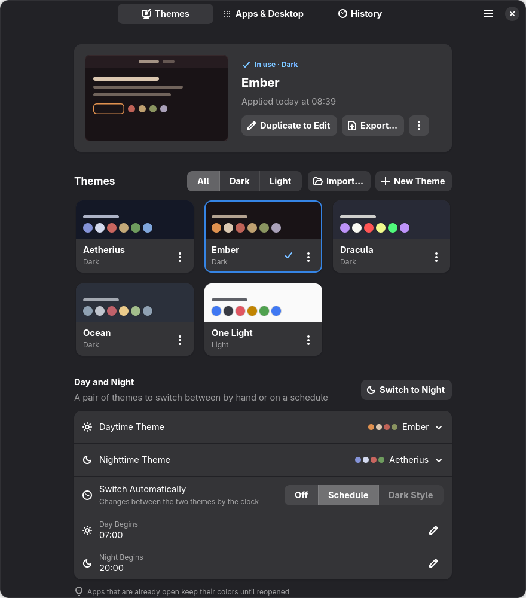
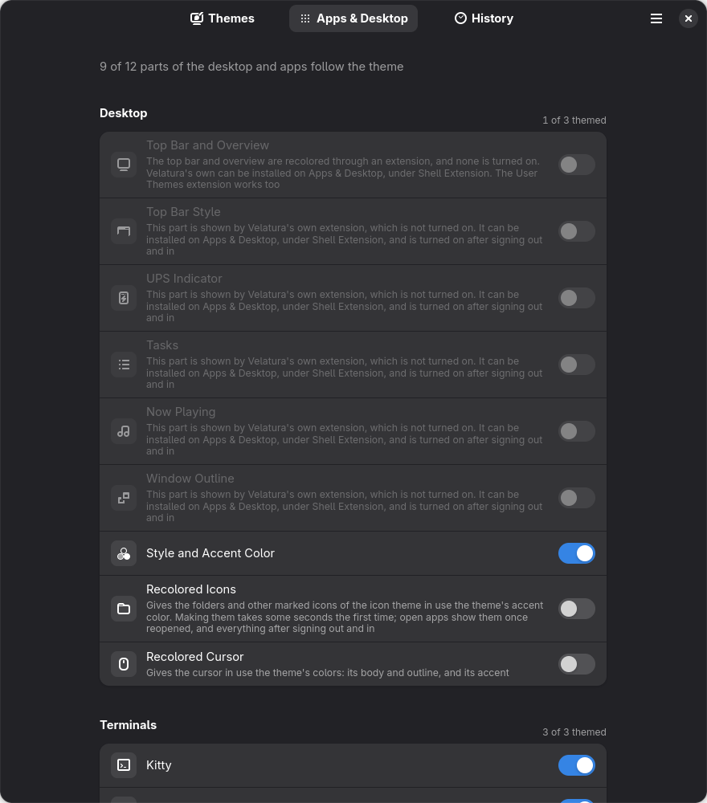
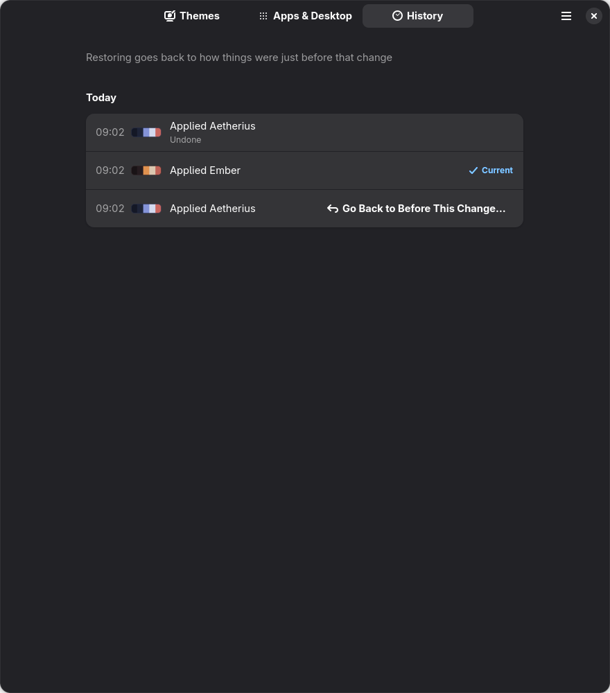

# Velatura

**One color theme for the whole GNOME desktop, applied from one place.**

Velatura takes a theme (a background, a text color, an accent and the rest of
a palette) and applies it everywhere it can: the top bar and overview, GTK and
libadwaita apps, terminals, Neovim, tmux, Starship, Text Editor, Firefox, and
even the icons and cursor. Every change is backed up and can be undone, also
from a text console if a theme ever makes the desktop hard to read.



Status: **0.2.0**. The app and the `velatura` command work; the parts marked
*Unofficial* or *experimental* below may stop working after a GNOME or Firefox
update.

This page follows the `main` branch. Tasks, Now Playing and installing the
Shell extension along with Velatura came after 0.2.0, so for now they need an
install from source.

## What it does

- **Applies a theme in one step.** Select a theme's card and Velatura writes
  the colors for each app, sets the dark or light style and the nearest system
  accent, and says what is left to do (some apps need reopening).
- **Asks before touching your files.** The first time it adds a line to an
  app's settings, or when a theme has low contrast, it shows what will change.
  Nothing of yours is deleted.
- **Keeps a history.** Every apply makes a backup. Undo the last one, go back to
  before any earlier change, or remove everything Velatura ever added.
- **Day and night.** Pick a daytime and a nighttime theme, then switch by hand,
  on a schedule, or with GNOME's own light and dark style.
- **Your own themes.** Make one in the editor from three colors, or import
  base16, base24 and Kitty themes, and export any theme to share it.
- **Icons, wallpaper and fonts** can be chosen from the same window.
- **Templates** put a theme's colors into any other app's config file.
- **Warns about overlaps.** It names other tools and extensions that keep their
  own colors, and warns when another extension may show or draw the same thing
  as one of its parts. Nothing of theirs is changed.

## What it themes



| Part | How | Support |
| --- | --- | --- |
| Style and accent color | GNOME's own settings | Official |
| Top bar and overview | The User Themes extension, or Velatura's own Shell extension | Unofficial |
| Top bar style | The bar as one full bar or as a pill per button, as opaque as chosen, through Velatura's extension | Unofficial |
| UPS indicator | The watts a UPS draws, in the top bar, read from Network UPS Tools by Velatura's extension | Unofficial |
| Tasks | A checklist left of the clock in the top bar, shown by Velatura's extension, which keeps the tasks | Unofficial |
| Now playing | The media player in use, right of the clock in the top bar, with its track and controls, shown by Velatura's extension | Unofficial |
| Window outline | A line in the accent around the window in use, drawn by Velatura's extension | Unofficial |
| Apps (GTK 4 and libadwaita) | Color overrides in `~/.config/gtk-4.0/gtk.css` | Unofficial |
| Older apps (GTK 3) | The same, through the adw-gtk3 theme | Unofficial |
| Flatpak apps | Read access to the GTK settings folders | Unofficial |
| Kitty, Ghostty, Ptyxis | Each terminal's own theme or palette files | Official |
| Neovim, tmux, Starship | A colorscheme, a sourced file, a palette | Official |
| Text Editor | A GtkSourceView style scheme | Official |
| Firefox | `userChrome.css` in the default profile | Experimental |
| Recolored icons and cursor | A copy of the icon or cursor theme in use, in the theme's colors | Experimental |
| Qt apps | A template for qt6ct | By hand |

Not possible: the lock screen, the login screen, and apps that draw their own
colors. The details, with what each part needs, are in
[Theming targets](https://rafael0rueda.github.io/Velatura/targets.html).



## Install

Velatura runs on **GNOME 47 or newer** (Fedora, Ubuntu's GNOME session, and
others), on x86_64. It installs for your user only and needs no root.

**From a release.** Download `velatura-<version>-x86_64-linux.tar.gz` from
[Releases](https://github.com/rafael0rueda/Velatura/releases), then:

```sh
tar xf velatura-*-x86_64-linux.tar.gz
cd velatura-*-x86_64-linux
./install.sh                 # into ~/.local/bin and ~/.local/share
./install.sh --uninstall     # takes exactly those files out again
```

Check the download against `SHA256SUMS` from the same release.

**From source.** You need Rust 1.89 or newer, GTK 4.16 and libadwaita 1.6 with
their development files (on Fedora: `gtk4-devel libadwaita-devel`).

```sh
git clone https://github.com/rafael0rueda/Velatura.git
cd Velatura
scripts/install-local.sh     # builds, then installs into ~/.local
```

Both install Velatura's Shell extension as well, and bring it up to date
when it is updated; GNOME Shell takes a new copy after signing out and in.
The top bar's colors and the parts drawn in it need it turned on, once, in
Extensions; the top bar's colors can also come through User Themes.

**Optional extras.** For older GTK 3 apps, install
[adw-gtk3](https://github.com/lassekongo83/adw-gtk3).

## Use

Open **Velatura** from the app grid. Select a theme's card to apply it; the
toast that follows has **Undo**. A card's ⋮ button (or right-click, long press,
or the Menu key) opens its menu: Details, Preview Changes, Edit, Export and
Remove.

Everything the app does, the `velatura` command does too:

```sh
velatura list                     # themes that can be applied
velatura apply ember              # apply a theme
velatura apply ember --preview    # show what would change, change nothing
velatura status                   # the theme in use, and each part's state
velatura switch set day ember     # choose the daytime theme (or night)
velatura schedule set --day 07:00 --night 20:00
velatura theme import dracula.conf
velatura undo                     # reverse the most recent change
velatura history                  # backups, newest first
velatura doctor                   # check this system
```

`velatura --help` lists every command.

### If the desktop becomes unreadable

Switch to a text console with **Ctrl+Alt+F3**, sign in, and run:

```sh
velatura undo                  # reverse the last theme
velatura restore --original    # remove everything Velatura added
```

Then go back to the desktop with Ctrl+Alt+F2 (or F1).

## Documentation

The documentation is HTML in [`docs/`](docs/index.html), and online at
<https://rafael0rueda.github.io/Velatura/>:

- [Plan](https://rafael0rueda.github.io/Velatura/plan.html) and
  [Architecture](https://rafael0rueda.github.io/Velatura/architecture.html)
- [Theming targets](https://rafael0rueda.github.io/Velatura/targets.html):
  how each part is themed, and its limits
- [Interface guidelines](https://rafael0rueda.github.io/Velatura/hig.html):
  how the app follows the GNOME HIG
- [Decisions log](https://rafael0rueda.github.io/Velatura/decisions.html)
- [Workflow](https://rafael0rueda.github.io/Velatura/workflow.html):
  how changes are made and tested
- [Changelog](https://rafael0rueda.github.io/Velatura/changelog/index.html)

Velatura's own window always keeps libadwaita's stock colors, so it stays
readable whatever theme is applied. Bug reports about apps under a theme
belong here, not with those apps' developers: libadwaita does not support
recoloring.

The app is in English and Spanish.

## License

[GPL-3.0-or-later](LICENSE).
