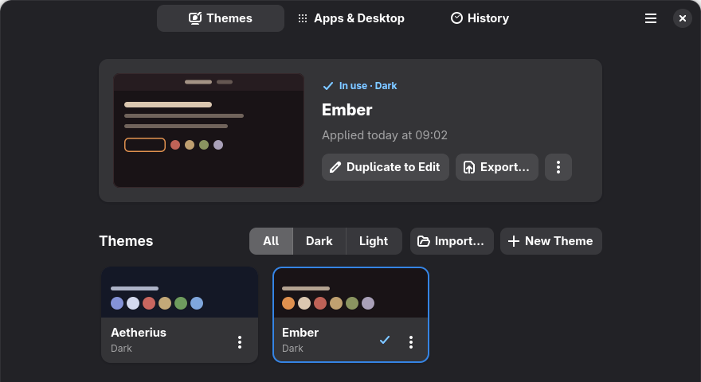
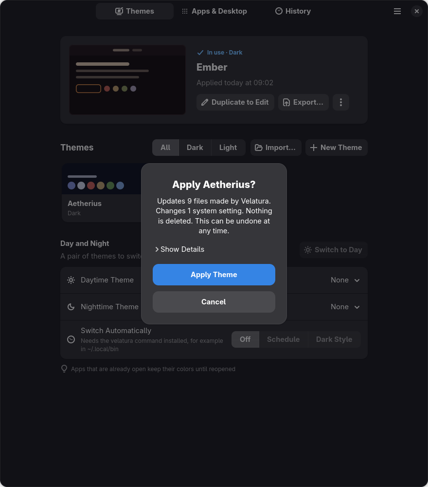
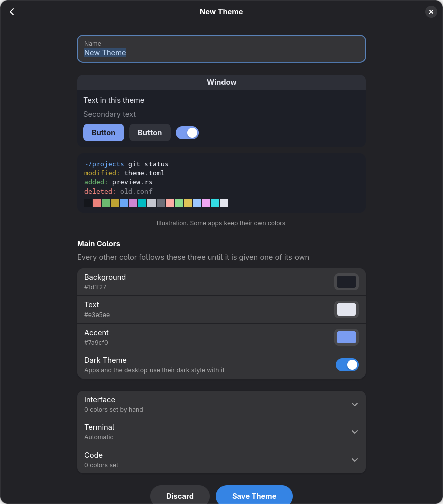
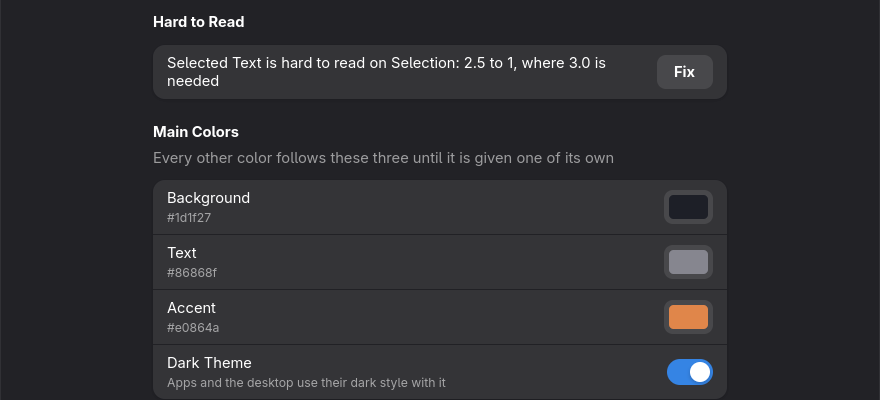

# Velatura User Manual

Velatura gives your whole GNOME desktop one set of colors. Instead of changing
each app one by one, you choose a theme once and Velatura applies it to the top
of your screen, your apps, your terminal windows and more. You can also create
your own themes without writing any code.

This manual is for everyday computer users. You don't need to know how to
program, and you only need the Terminal app to install Velatura and in one
rare emergency. Both are explained step by step.

**Contents**

1. [Welcome](#1-welcome)
2. [Getting started](#2-getting-started)
3. [Using a theme](#3-using-a-theme)
4. [Creating your own theme](#4-creating-your-own-theme)
5. [Day and night themes](#5-day-and-night-themes)
6. [Choosing what gets themed](#6-choosing-what-gets-themed)
7. [Going back](#7-going-back)
8. [If something goes wrong](#8-if-something-goes-wrong)
9. [Extras](#9-extras)

## 1. Welcome

### What is a theme?

A theme is a named set of colors: mainly a background, a text color and one
highlight color. Velatura comes with two themes, **Aetherius** and **Ember**.
You can create as many more as you like, or add ones made by other people.

### You can't easily break anything

Trying things out is safe:

- **Velatura makes a backup every time it applies a theme.**
- **It doesn't delete your files.** It may add a line to an app's settings, and
  it tells you the first time it needs to.
- **You can always go back.** Undo the last change, return to any earlier
  point, or remove everything Velatura ever added.

### What Velatura can't change

- The lock screen and the login screen.
- Apps that draw their own colors. These simply stay as they are.

Some parts of the desktop are colored in ways GNOME and Firefox don't officially
support, so they may stop working after an update. The app marks these parts,
and [section 6](#6-choosing-what-gets-themed) explains what that means.

## 2. Getting started

### What you need

- **GNOME 47 or newer.** To check, open **Settings → System → About**.
- **A 64-bit Intel or AMD computer.** Most desktop and laptop PCs are.

### Installing Velatura

Installing doesn't need an administrator password. Velatura is only installed
for your own user account.

1. Go to the [Velatura releases page](https://github.com/rafael0rueda/Velatura/releases).
2. Download the file with a name like `velatura-0.2.0-x86_64-linux.tar.gz`. It
   normally goes into your Downloads folder.
3. Open the **Terminal** app. On some systems it's called **Console** or
   **Ptyxis**.
4. Copy each line below, paste it into the Terminal with **Ctrl+Shift+V**, and
   press **Enter**.

   Go to your Downloads folder. If your system is in another language, the
   folder may have another name, such as `Descargas`, so use that name instead:

   ```sh
   cd ~/Downloads
   ```

   Unpack the download:

   ```sh
   tar xf velatura-*-x86_64-linux.tar.gz
   ```

   Go into the unpacked folder:

   ```sh
   cd velatura-*-x86_64-linux
   ```

   Install Velatura:

   ```sh
   ./install.sh
   ```

5. When you see a message starting with "Installed", close the Terminal.
6. Keep the unpacked folder. You'll use it if you ever
   [uninstall Velatura](#uninstalling-velatura).

> **If a line reports an error:** you may have an older Velatura download or
> unpacked folder in Downloads. Delete the older ones and try that line again.

Open **Velatura** from your app grid, the same way you open any other app.

### A quick tour

The buttons at the top of the window switch between three views:

| View | What it's for |
| --- | --- |
| **Themes** | Choose, create and share themes, and set up day and night themes |
| **Apps & Desktop** | Choose which parts of your desktop follow the theme |
| **History** | See your past changes and go back to any of them |

The menu button (☰) in the top right has **Undo Last Change**,
**Troubleshooting**, **Keyboard Shortcuts** and **About Velatura**.



Velatura's own window always keeps its normal colors, whatever theme you
apply. This keeps it readable even if a theme turns out badly.

## 3. Using a theme

### Apply a theme

1. Open the **Themes** view.
2. Select a theme's card.
3. The first time, Velatura asks you to confirm and lists what it will change.
   Select **Apply Theme**.



Velatura shows a short message when it's done. It has an **Undo** button if you
change your mind straight away. Sometimes a page called **A few things to know**
appears instead, with anything you need to do yourself.

### When Velatura asks first

After the first time, most themes apply without a question. Velatura asks again
in two cases:

- **It needs to add a line to an app's settings file for the first time.**
  This is normal, and it's what connects that app to your themes.
- **The theme's text may be hard to read.** The button then says **Apply
  Anyway**, so you can't accept it by accident.

### Why an app didn't change

Apps that are already open usually keep their old colors. Close and reopen them
to see the new theme.

### What the card's menu does

Each card has a **⋮** button. You can also right-click the card.

| Menu item | What it does |
| --- | --- |
| **Details** | Shows a larger preview and facts about the theme |
| **Preview Changes…** | Shows what applying the theme would change, without changing anything until you confirm |
| **Duplicate to Edit** | Makes your own copy of a built-in theme to change |
| **Edit Theme** | Changes a theme of your own |
| **Export…** | Saves the theme as a file you can share |
| **Remove Theme** | Takes a theme of your own out of the list |

You'll see either **Duplicate to Edit** or **Edit Theme**, depending on the
theme. Built-in themes can't be changed directly or removed.

## 4. Creating your own theme

### The three colors that matter

You only have to choose three colors. Velatura works out all the others from
them.

| Color | What it colors |
| --- | --- |
| **Background** | The main surface of windows |
| **Text** | Words on that background |
| **Accent** | Highlights such as main buttons, switches and selected items |

### Create your first theme

1. In the **Themes** view, select **New Theme**.
2. In **Name**, type a name for your theme.
3. Under **Main Colors**, select the color box next to **Background**.
4. Pick a color, or select **+** to mix your own, then select **Select**.
5. Do the same for **Text** and **Accent**.
6. Turn on **Dark Theme** if your background is dark, or turn it off if your
   background is light. This tells your apps which style to use.
7. Check the preview at the top of the page. It updates with every change.
8. Select **Save Theme**.

Your theme now has its own card. **Saving doesn't apply it**, so select the card
when you're ready to use it.



The preview is only an illustration, and some apps keep their own colors. The
real test is to apply the theme and look at your desktop. If you don't like it,
select **Undo**.

### Start from an existing theme

It's often easier to adjust a theme you already like:

1. Open the theme card's **⋮** menu.
2. Select **Duplicate to Edit** for a built-in theme, or **Edit Theme** for one
   of your own.
3. Change what you like and select **Save Theme**.

A copy of a built-in theme is named, for example, "Ember (Copy)". You can rename
it.

### Choosing colors that work

- **Make the background and text very different.** Choose dark on light or light
  on dark. If you have to squint at the preview, it's too close.
- **Use a soft background.** A very dark gray or an off-white is easier on the
  eyes for long periods than pure black or pure white.
- **Make the accent the one bright color.** It should stand out from the
  background without being harsh.
- **Pick the background first.** It covers the most space and sets the mood.

To enter any of these starter colors, select **+** in the color chooser and type
the code. All of them pass Velatura's readability check.

| Theme idea | Style | Background | Text | Accent |
| --- | --- | --- | --- | --- |
| Deep Sea | Dark | `#10202b` | `#dbe7ee` | `#4fb3bf` |
| Forest Night | Dark | `#1a241c` | `#e4e8d8` | `#8fbf6a` |
| Plum | Dark | `#241a2e` | `#eae0f0` | `#c08ad8` |
| Warm Paper | Light | `#f6f0e4` | `#33291f` | `#a8501f` |
| Morning Sky | Light | `#f2f6fa` | `#1e2a36` | `#2a6fb0` |

### The "Hard to Read" warning

If two colors are too similar, a **Hard to Read** section appears in the editor.
For example:

> Selected Text is hard to read on Selection: 2.5 to 1, where 3.0 is needed

The numbers measure contrast, which is how different two colors look. A higher
number is easier to read, and the message tells you the lowest number needed.

Select **Fix** and Velatura adjusts the color for you. You can also change the
color yourself. The warning goes away once the colors are different enough.



Velatura won't stop you from saving a hard-to-read theme, but it will warn you
again if the main text is too faint when you apply it.

### Fine-tuning (optional)

You can skip this part. Below the main colors are three sections you can open
to control individual colors:

| Section | What it controls |
| --- | --- |
| **Interface** | Details of app windows, such as borders, selections, links, and success, warning and error messages |
| **Terminal** | The 16 colors used in terminal windows |
| **Code** | Colors for different parts of program code in text editors and in Neovim |

Most colors here start as **Automatic**, which means they follow your three main
colors. If you change the main colors later, automatic ones change with them.

Once you pick a color yourself, it's set by hand and stays as it is. To make it
automatic again, select the ↶ button next to it. For the terminal colors, use
**Reset Terminal Colors to Automatic**.

### Change a theme later

1. Open the card's **⋮** menu and select **Edit Theme**.
2. Make your changes and select **Save Theme**.

> **If the theme you edited is the one in use:** saving doesn't update your
> desktop, and selecting its card does nothing because it's already in use. To
> see your changes, open the card's **⋮** menu, select **Preview Changes…**, then
> select **Apply Theme**.

To leave the editor without saving, select **Discard**. The back arrow also
leaves, and asks you to confirm first if you've changed anything.

### Remove a theme

Open the card's **⋮** menu and select **Remove Theme**. Select **Undo** in the
message that follows if you change your mind.

Removing the theme you're using doesn't change your desktop's colors. It stays
as it is until you apply another theme.

### Share a theme

**To give a theme to someone:**

1. Open the card's **⋮** menu and select **Export…**.
2. Choose where to save it. You get a small file ending in `.toml`.
3. Send them that file.

**To add a theme someone made:**

1. In the **Themes** view, select **Import…**.
2. Choose the file.
3. Check the preview and select **Import**. The theme gets its own card.

Theme files contain only colors and names. They can't run anything on your
computer.

Velatura also reads theme files made for other tools, which is an easy way to
get many ready-made themes:

- **Base16 and Base24** themes, whose files end in `.yaml` or `.yml`. There's a
  large collection at [tinted-theming/schemes](https://github.com/tinted-theming/schemes).
- **Kitty** themes, whose files end in `.conf`. There's a large collection at
  [kovidgoyal/kitty-themes](https://github.com/kovidgoyal/kitty-themes).

These files don't say which color is the accent, so Velatura may ask you to
choose one when you import them.

If a theme with the same name is already in your list, Velatura asks what to do.
**Keep Both** adds it alongside the existing one, and **Replace** overwrites
yours. **Replace** isn't offered for built-in themes.

## 5. Day and night themes

You can choose one theme for the day and another for the night, then switch
between them by hand or automatically.

1. In the **Themes** view, go to **Day and Night**.
2. Choose a **Daytime Theme** and a **Nighttime Theme**.
3. Choose how to switch using **Switch Automatically**:

| Choice | What happens |
| --- | --- |
| **Off** | You switch yourself with the **Switch to Night** or **Switch to Day** button |
| **Schedule** | The theme changes at the times you set in **Day Begins** and **Night Begins** |
| **Dark Style** | The theme follows GNOME's own light and dark style |

Write times in 24-hour format, such as `07:00` or `20:30`, then select the check
mark to confirm.

If a choice is grayed out, the text next to it says why:

- **Schedule** and **Dark Style** need both themes chosen first.
- **Dark Style** also needs a light daytime theme and a dark nighttime theme.
  Velatura only comes with dark themes, so you'll need to create or import a
  light one first. Try one of the light
  [starter colors](#choosing-colors-that-work).

If Velatura finds another timer that may change your theme, it warns you first,
because two schedules would work against each other.

Apps that are already open keep their colors until you reopen them.

## 6. Choosing what gets themed

The **Apps & Desktop** view lists every part Velatura can color, each with its
own switch.


### Turning parts on and off

1. Turn a part's switch on or off.
2. Select **Apply Changes to** followed by your theme's name. The change only
   takes effect when you do this.

### What the labels mean

| You see | What it means |
| --- | --- |
| **Not installed** | You don't have this app, so there's nothing to color |
| **How to Install** | A button that opens a page about something this part needs |
| **Unofficial** | It works, but it may stop working after a GNOME or Firefox update. Your computer stays safe |
| **Set up, but not taking effect** | Something else is overriding it. The text beside it says what |
| **Included when a theme is next applied** | Turned on, and waiting for **Apply Changes** |
| **Taken away when a theme is next applied** | Turned off, and waiting for **Apply Changes** |

Some parts need extra steps:

- **Firefox** must have been opened at least once.
- **Flatpak Apps** lets apps installed through Flatpak, including many from the
  Software app, read the theme's colors.
- **Older Apps (GTK 3)** needs an extra free theme called adw-gtk3. Select **How
  to Install** for instructions.

### The Velatura extension

The top of your screen is colored by a small add-on called a GNOME Shell
extension. Several other parts need it too: **Top Bar Style**, **UPS Indicator**,
**Tasks**, **Now Playing** and **Window Outline**.

To turn it on:

1. In **Apps & Desktop**, go to **Shell Extension**. If you see an **Install** or
   **Update** button, select it.
2. Sign out of your computer and sign back in.
3. Open the **Extensions** app and turn on **Velatura**. If you don't have
   Extensions, you can get it from your Software app.
4. Back in Velatura, turn on the parts you want and select **Apply Changes**.

### Extras for your top bar

These parts need the Velatura extension. Tasks and Now Playing are new and came
after version 0.2.0, so they may not be in your copy yet.

- **Top Bar Style** shows the bar as a **Complete Bar** or as separate **Pills**,
  with an **Opacity** setting for how see-through it is.
- **Tasks** puts a simple checklist to the left of the clock. Select it, type a
  task in **Add task** and press **Enter**. Tick tasks off when they're done.
  Your tasks stay on your computer.
- **Now Playing** shows the app playing music or video to the right of the clock.
  Select it to see the track and controls, or middle-click it to play or pause.
  It stays hidden while nothing is playing.
- **UPS Indicator** is for people with a backup battery unit (a UPS) already set
  up with a program called Network UPS Tools. Without that, it stays hidden.
- **Window Outline** draws a thin line in your accent color around the window
  you're using.

Another extension may already show or draw the same thing. If so, Velatura warns
you beside that part. It never changes other extensions, so you can decide which
one to keep.

### Icons, wallpaper and fonts

Under **Icons, Wallpaper and Fonts**, you can choose your icons, cursor, wallpaper
and fonts from what's installed on your computer. These choices stay the same
when you change theme.

To make icons and the cursor match your theme instead, turn on **Recolored Icons**
or **Recolored Cursor** under **Desktop**. The first time, this can take some
seconds. Open apps show the new icons once reopened, and everything shows them
after you sign out and back in.

## 7. Going back

### Undo the last change

Select **Undo** in the message after applying a theme, or open the ☰ menu and
select **Undo Last Change**. You can also press **Ctrl+Z**.

### Go back to an earlier point

The **History** view lists your changes by day, with the newest first.

1. Find the change you want to reverse.
2. Select **Go Back to Before This Change…**.
3. Select **Go Back** to confirm.

This undoes that change and every change after it.


### Remove everything Velatura added

At the bottom of **Apps & Desktop**, select **Remove Everything Velatura Added**.
This returns your desktop to how it was before Velatura and turns off any
schedule. Select **Undo** in the message if you change your mind.

## 8. If something goes wrong

| What you see | What to do |
| --- | --- |
| An open app kept its old colors | Close it and open it again |
| Open Kitty terminal windows kept the old colors | Press **Ctrl+Shift+F5** in each one |
| The top bar didn't change | Turn on the [Velatura extension](#the-velatura-extension). If it's already on, another extension may be coloring the bar. Check the text under **Top Bar and Overview** |
| A part is grayed out in **Apps & Desktop** | Read the text under its name, which explains why |
| A part stopped working after a system update | It's probably marked **Unofficial**. Check for a newer version of Velatura |
| **High Contrast is on, so apps are not recolored** | Turn off High Contrast in **Settings → Accessibility** if you want themes on your apps |
| **An earlier change was interrupted** | Select **Roll Back**. This can happen if the computer shut down during a change |
| A timer or schedule warning | Open ☰ → **Troubleshooting** to see other tools that may be changing your colors |
| An app looks wrong under a theme | Report it to Velatura, not to the app's developers. Recoloring is Velatura's doing, not theirs |

**Troubleshooting** in the ☰ menu lists the state of every part, along with other
tools that may be changing the same colors.

### If your desktop becomes unreadable

If a theme makes your screen too hard to use, you can undo it from a plain text
screen. Your computer isn't damaged, and this only takes a minute.

1. Press **Ctrl+Alt+F3**. The screen turns into a black page of text.
2. Type your username and press **Enter**.
3. Type your password and press **Enter**. Nothing appears on the screen while
   you type your password. That's normal.
4. Type this and press **Enter** to reverse the last theme:

   ```sh
   velatura undo
   ```

5. To get back to your desktop, press **Ctrl+Alt+F2**. If that doesn't work, try
   **Ctrl+Alt+F1**.

If the desktop is still unreadable, repeat steps 1 to 3, then remove everything
Velatura added:

```sh
velatura restore --original
```

If you see "command not found", type this instead:

```sh
~/.local/bin/velatura undo
```

## 9. Extras

### Keyboard shortcuts

| Keys | Action |
| --- | --- |
| **Ctrl+Z** | Undo the last change |
| **Ctrl+N** | New theme |
| **Ctrl+O** | Import a theme |
| **Ctrl+S** | Save the theme you're editing |
| **Alt+Left** | Go back |
| **F10** | Open the main menu |
| **Ctrl+?** | Show keyboard shortcuts |
| **Ctrl+W** | Close the window |
| **Ctrl+Q** | Quit |

### Glossary

| Word | Meaning |
| --- | --- |
| **Accent** | The highlight color of a theme, used on main buttons, switches and selected items |
| **Apply** | Put a theme's colors on your desktop and apps |
| **Contrast** | How different two colors look. More contrast is easier to read |
| **Dark style / light style** | GNOME's two basic looks: light text on dark, or dark text on light |
| **Extension** | A small add-on that changes how the GNOME desktop works |
| **Flatpak** | A common way of installing apps on Linux. Many apps in the Software app use it |
| **Overview** | The screen you get by pressing the Super key, showing your windows and apps |
| **Terminal** | An app where you control your computer by typing commands |
| **Top bar** | The bar along the top of your screen, with the clock |

### Uninstalling Velatura

1. Open Velatura. At the bottom of **Apps & Desktop**, select **Remove Everything
   Velatura Added**, so your desktop goes back to how it was.
2. Open the **Terminal** and go to the folder you kept from installing. Use the
   name of your download folder if it's different:

   ```sh
   cd ~/Downloads/velatura-*-x86_64-linux
   ```

3. Remove the app:

   ```sh
   ./install.sh --uninstall
   ```

Velatura keeps your backups and history in your home folder, in case you install
it again.

### Language

Velatura is available in English and Spanish, and uses your system's language.

### Getting help

To report a problem or ask a question, open an issue on the
[Velatura issues page](https://github.com/rafael0rueda/Velatura/issues). Include
your GNOME version and what you see in ☰ → **Troubleshooting**.

### For the curious

Everything in the app can also be done with the `velatura` command in a Terminal,
and templates can put a theme's colors into other apps' settings. Neither is
needed for everyday use. Type `velatura --help` to see the commands, or read the
[project's README](../README.md).
